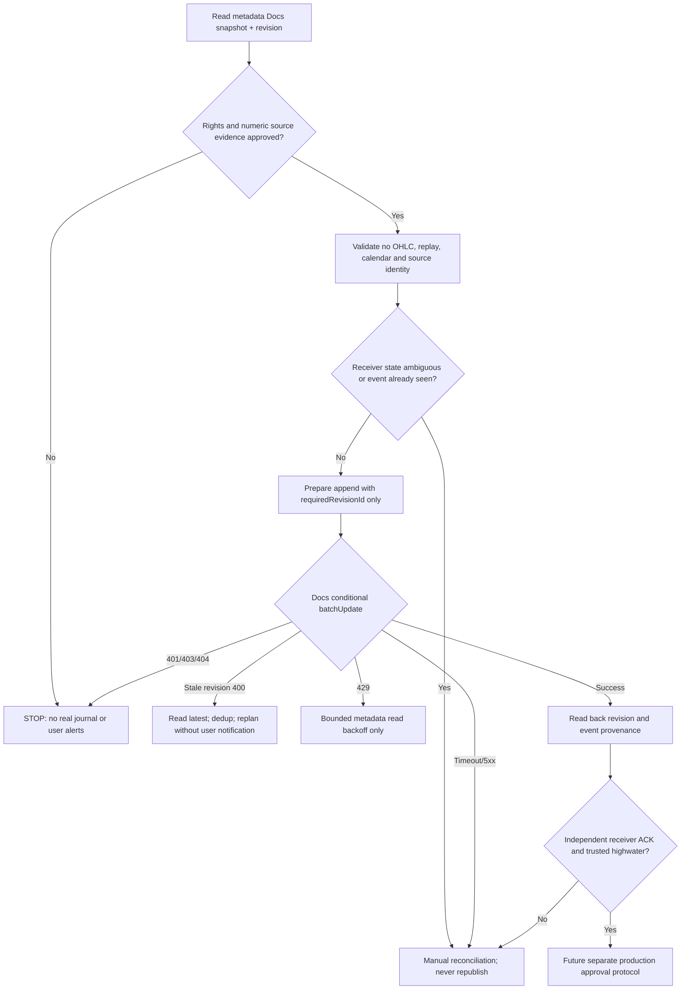

# A04/P0.26 — Google Docs revision CAS vs Drive files.update: READ-ONLY GO/NO-GO

**Verdict: NO-GO for a REAL shared event journal today.** Conditional Google Docs writes are a documented candidate; they do not alone establish full safe storage, license, trusted antirollback, multiwriter replay protection, external notification exactly-once or original Forex Trading 1:1 numerical strategies. No production signals, actual event-doc writes or licensed OHLC are authorized by this checkpoint.

## Source-verified API / actual connected action contracts

1. [Google Docs documents.batchUpdate official reference](https://developers.google.com/workspace/docs/api/reference/rest/v1/documents/batchUpdate) (Google page last updated 2026-07-07): requests in a valid batch are applied **atomically**. `WriteControl.requiredRevisionId` rejects a stale revision (HTTP 400); `targetRevisionId` instead incorporates collaborator changes and is **not a strict CAS guard**. Use only `requiredRevisionId` for future research CAS, not target revision, unguarded writes, `replaceAllText` without revision, or a read-only modified-time comparison.
2. Connected Google Drive app action `mcp__Google_Drive__batch_update_document` accepts `write_control.requiredRevisionId` and Docs `get_document_text` returns a revision ID (verified read-only tool schemas). This proves a typed write **capability**, not that MFX has a storage authorization or that server-side multiworker race has been exercised.
3. [Drive files.update official reference](https://developers.google.com/workspace/drive/api/reference/rest/v3/files/update) and connected `mcp__Google_Drive__update_file`: no typed/explicit expected revision or If-Match conditional write control exposed in the installed action. Therefore a generic raw Drive file overwrite **cannot be treated as a safe atomic lock under this integration**. A File.version/modifiedTime/ETag observation without an enforced write precondition is not CAS. This is a connector-specific NO-GO, not a universal theoretical claim about all Google Drive clients.
4. [Google Docs usage limits](https://developers.google.com/workspace/docs/api/limits) currently list 60 write requests/min/user/project and 600 write requests/min/project, 429 on quota and exponential backoff. They are quotas, not latency or guaranteed throughput. Do not use automatic retry after possibly delivered alerts.

## Fail-closed protocol for a FUTURE approved disposable metadata-only Doc

This diagram is **design-only**: the input rights/owner numerical requirements are not satisfied in the current project, so the execution path stops at the first gate. The branch does NOT make a network request, create or update a Google Doc journal, schedule a workflow, or call a market-data provider/broker. Actual Docs revision IDs and API errors were not exercised on a disposable event journal.

## Failure and evidence distinctions

- Stale required revision explicitly diagnosed by Docs: HTTP 400; **not** all 400 errors imply stale revision. Generic invalid 400 -> STOP; stale 400 -> retrieve latest metadata, check tombstone and new authorization, no external publish.
- `targetRevisionId` is collaborative merge/rebase and may combine edits, not an exclusive write precondition. Never use it as a race lock.
- 401/403/404 -> access/document STOP, do not retry as unguarded write; 429 -> bounded backoff for metadata read and no alert; timeouts or 5xx **after an attempted write** -> UNKNOWN_COMMIT and manual compare/readback, never assume the write failed.
- SHA-256 checksum chain remains a tamper detection aid, not a separately trusted anti-rollback signature. An attacker who can rewrite both data and checksum is not stopped without external highwater/trust authority.
- Two mock workers racing at one revision have one winner only **in the in-memory test**. True Google Docs multi-actor/server consistency, ACL revocation, concurrent collaborator changes, revision validity, quota accounting, retention and readback must be verified in a separate explicitly authorized disposable-document protocol.
- Even a correctly appended journal does not prove delivery: an attempt without a receiver-generated idempotent acknowledgement is `DELIVERY_AMBIGUOUS`, not `DELIVERED` and not a retryable BUY/SELL alert.

## Source / release hard STOP

- Source frozen Forex Trading 1.0 Git commit `7e1c1c012b1b189be5ad7b9d07756eac012a8309`, 102 imported original blobs, 30 frozen domain modules, 11 frozen Google Docs unchanged; MFX parent P0.25 protected main `bc5d19e6f24e95c60e076ac211a260854f63fbea` with independent prior push [run 42666677548](https://github.com/ngluonghoa/MFX/actions/runs/42666677548) 3/3 PASS.
- [Issue #27](https://github.com/ngluonghoa/MFX/issues/27) remains BLOCKED for live licensed Forex OHLC, Drive price-cache rights and native broker BID/ASK calendars/cost/OOS. **0/15 candidate entry numeric strategies approved, 36/36 B2/S2 original numeric rules unapproved.** Real BUY/SELL signals and production releases are prohibited by lack of source-calibrated evidence; no broker orders ever in user-approved signal-only scope.
- No actual Google Docs event journal writes, Drive raw price-cache writes, vendor quote calls or notification sends. Files developed/CI/QA only in Cloud GitHub+Google Drive, not Mac/MOCHI/local.

## This P0.26 test implementation

`mfx_research/p026_docs_cas_readiness.py`: strict SIM-only read/append/rights/clock and conditional revision oracle, no cloud adapter. `tests/test_a04_p26_docs_cas_readiness.py`: **20 preregistered groups** in [Issue #41](https://github.com/ngluonghoa/MFX/issues/41#issuecomment-6747314814), independently checking race, revision, duplicate, future known, fake authority, 400/403/429/5xx and quota. `tools/run_a04_p26_docs_contract_demo.py`: CI-only 20-method proof and explicit zero external writes/releases. Previous P0.1–P0.25 CI remains, strict Ruff/mypy/security/parity/wheel; only six non-src files in PR including CI and exact SHA manifest.

**Future GO decision (separate authorization)** requires a dedicated write-scoped metadata storage approval, disposable Docs 2-worker real server test and revocation/quota test, durable external highwater and receiver ACK design, original Forex numerical source approval, licensed actual quote/Drive market data permissions and chronological FX BID/ASK/OOS cost qualification. This checkpoint specifically does **not** give that GO decision.
